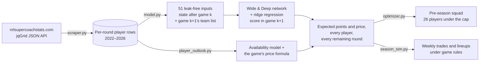
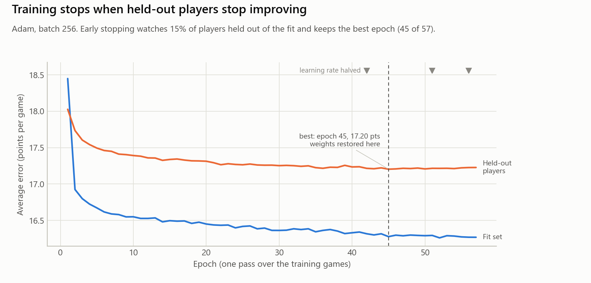
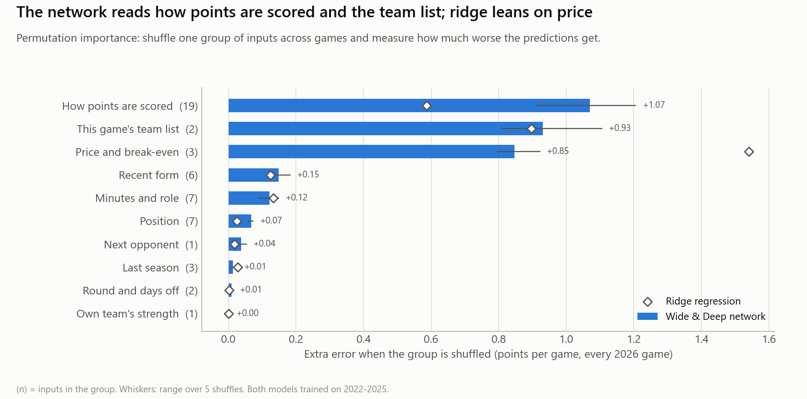
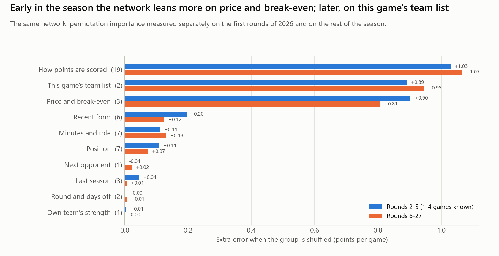
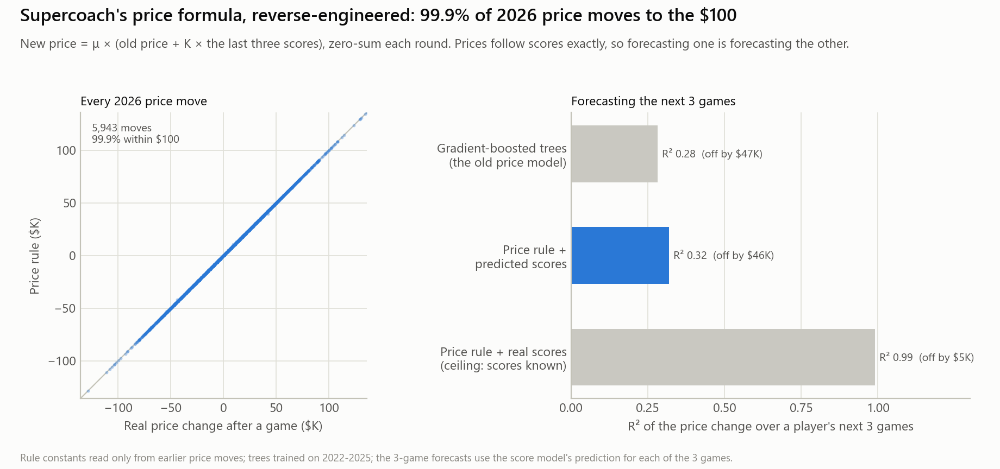

# NRL Supercoach Optimizer

[](https://github.com/M-Attwood/NRL-Super-Team-Stats/actions/workflows/tests.yml)


An end-to-end machine-learning system that plays **NRL Supercoach**, the rugby league fantasy game, for a whole season:

- a **TensorFlow Wide & Deep neural network** predicts every player's score in their next game
- gradient-boosted trees predict whether each player will be picked
- the game's own **price formula, reverse-engineered from the data**, projects how every price will move
- integer linear programming picks a 26-man squad under the $11.95M salary cap
- a trading strategy adapts the squad every week within the game's rules

I ran it live during the 2026 season. This repository is the final version: the code is cleaned up, and the whole 2026 season is replayed under the game's rules to show what the system would have scored.


## Results at a glance

| | |
|---|---|
| **Neural network** | Wide & Deep network with 51 inputs, including the team list for the game it predicts, and 5,493 trained weights. Trained on 25,284 games (2022–2025), then predicted all **6,407 games of 2026**, each before it was played |
| **Prediction accuracy** | Averaged with a ridge regression, average error was **16.76 points per game**, against 18.08 for the season-average heuristic coaches use. R² rose from 0.15 to 0.26 |
| **Price model** | Supercoach's price formula, reverse-engineered: it reproduces **99.9% of 2026 price moves to the $100** |
| **Full 2026 season, game rules** | **33,479 points**, an average of 1,240 a round, and 5,652 more than keeping the pre-season squad all year |
| **Against real coaches** | Beats the **average 2026 coach by 4,714** and my own real team by 5,523. It finishes 1,878 short of the top-10% average (35,357); the winner scored 37,196 |
| **Honest testing** | Every model and strategy setting was chosen on the 2024 and 2025 seasons; 2026 is held out as the test season and was run once |
| **Engineering** | Leak-proof feature pipeline, Keras, scikit-learn gradient boosting, PuLP/CBC integer programs, 74 unit tests, GitHub Actions CI |

## How it works



1. **Scrape** ([scraper.py](scraper.py)). The site's stats table is served by a jqGrid JSON endpoint. Each row is one player-round, with the score, minutes, jersey number, price and about 80 stat fields. The scraper is polite (rotating user-agents, jittered delays, exponential backoff) and caches finished seasons.
2. **Predict scores** ([model.py](model.py)). The neural network, described in depth below.
3. **Predict availability and price** ([player_outlook.py](player_outlook.py)):
   - **availability:** gradient-boosted trees estimate the chance a player is named for their team's next game (AUC 0.90). They use recent games, minutes, role, games missed in a row, and State of Origin (Origin weeks are read from the draw; Origin players are inferred from club games they sat out in those weeks)
   - **price:** Supercoach's own price formula, worked out from the data (section 2). Fed the predicted scores, it projects every player's price round by round
4. **Pick a squad** ([optimizer.py](optimizer.py)). A PuLP/CBC integer program chooses 26 players to maximise the predicted points of the 18 who score. Constraints: the salary cap, Supercoach's position quotas, dual-position eligibility, at most 5 players per club, and backup cover at every starting position.
5. **Trade through the season** ([season_sim.py](season_sim.py)). Each round it scores every legal trade by how much it improves the squad's expected scoring side across all remaining rounds (section 5).

## 1. The neural network

### The prediction problem

For every game a player has played, the network sees their **state after that game**, built only from games up to and including it, plus the **team list for the next game**, and learns to predict their **score in that next game**:

```
state after game k (games 1..k)  +  team list for game k+1   →   Supercoach score in game k+1
```

Every other input is a running statistic that stops at game k. The team list is the one exception, and it is published before the game: whether the player is named to start (jersey 1–13) or on the interchange (14–17). This assumes the final team list, which is what I had each week. [Tests](tests/test_no_target_leak.py) change a future score and check that no earlier input moves, and check that game k+1 contributes its jersey number and nothing it produced. This rule exists because my first model broke it (see [What I learned](#what-i-learned)).

The model that predicts 2026 learned from 25,284 such pairs from 2022–2025. The production model for next season is retrained on all 31,691, 2026 included.

### The 51 inputs

| Group | Inputs | What they capture |
|---|---:|---|
| Recent form | 6 | season average, last game, last-3 and last-5 averages, volatility, games played |
| Minutes and role | 7 | average, last-3 and last-game minutes, points per minute, started or came off the bench last game, share of games started |
| This game's team list | 2 | named to start, or on the interchange, for the game being predicted |
| How points are scored | 19 | season averages of the five Supercoach scoring components (base, attack, create, evade, negative) and of 14 stats such as tackles, line breaks, tries, goals, hit-ups and errors |
| Price and break-even | 3 | current price, break-even, price change so far this season |
| Last season | 3 | last season's average and games played, and whether the player has a last season |
| Next opponent | 1 | points the opponent has conceded to this position so far, shrunk toward the league average |
| Own team | 1 | the team's points per game relative to the league |
| Round and days off | 2 | round number, rounds since the player's last game |
| Position | 7 | one flag per position; dual-position players get two |

The team list is only out for the round about to be played. For later rounds the strategy averages the network's prediction over the roles a player could be named in, weighted by how often a player keeps his current role: a starter is still named to start 93% of the time one game later and 90% five games later, an interchange player stays on the bench 73% and then 58% of the time. Without that averaging the network, which had learned to trust the role, predicted later rounds slightly worse than a model without the team list.

### Architecture: Wide & Deep


The design follows Google's Wide & Deep model (Cheng et al., 2016):

- **The wide path** is a linear model on the standardised inputs, with its bias set to the average score.
- **The deep path** is a two-layer ReLU network that learns non-linear corrections and interactions.
- **The deep output starts at zero.** Training begins from a purely linear model, and the deep path only moves away from it where the data supports it. On a target this noisy (one game's score), that start keeps the network from fitting noise early.
- **Regularisation:** dropout (0.3, then 0.2) and L2 weight decay on both hidden layers.
- **The normalisation lives inside the model.** The saved model standardises its own inputs, so a prediction can't be served with mismatched scaling.

In total the network has 5,493 trained weights.

### Training

| | |
|---|---|
| Loss | Mean squared error, because the game rewards total points, so the network should predict the expected (mean) score |
| Optimiser | Adam, learning rate 1e-3, batch size 256 |
| Validation | 15% of **players** are held out of the fit. Splitting by player, not by game, means the stopping signal measures how well it predicts players it has never seen |
| Early stopping | Stops after 12 epochs without improvement on the held-out players and restores the best weights |
| Learning rate | Halved after 5 epochs without improvement (down to 1e-5) |
| Reproducibility | Fixed seed (42); the ridge weights are stored as plain numbers in [`model_card.json`](models/model_card.json), with no pickles |



The fit set's error keeps falling, but the held-out players' error flattens by about epoch 25. Early stopping keeps epoch 45, where the held-out error was lowest (17.20 points a game).

### How the architecture was chosen

Choices were made on the 2025 season (trained on 2022–2024, tested on every 2025 game), not on the season that is reported:

| Model (2025 season) | Trained weights | Error (pts/game) | R² | Rank correlation |
|---|---:|---:|---:|---:|
| Season average (the coaches' heuristic) | 0 | 17.88 | 0.109 | 0.440 |
| Previous production model (ensemble, no team list) | 5,413 | 16.65 | 0.227 | 0.488 |
| Plain neural network (64-32, no wide path) | 5,441 | 16.59 | 0.237 | 0.498 |
| Wide & Deep, 3 hidden layers (128-64-32) | 17,077 | 16.61 | 0.233 | 0.494 |
| Wide & Deep, Huber loss | 5,493 | 16.47 | 0.225 | 0.500 |
| **Wide & Deep (chosen)** | 5,493 | 16.59 | 0.235 | 0.496 |
| Ridge regression | 52 | 16.52 | 0.238 | 0.502 |
| **Wide & Deep + ridge, averaged (production)** | 5,545 | **16.52** | **0.240** | **0.501** |

What the comparison showed:

- **The team list is the biggest single gain.** Adding it took the production model from 16.65 to 16.52 points a game in 2025. It helped by a similar margin on 2024 (16.94 → 16.71) and on 2023, checked with models trained on 2022 alone (16.93 → 16.82).
- **The wide path no longer adds anything measurable.** With the team list in, the plain network matches Wide & Deep (16.59 each), and retraining with three seeds moves the error between 16.56 and 16.59. Wide & Deep is kept for its linear starting point, not for a measured win.
- **A bigger network was worse.** Three times the weights fitted more noise.
- **Huber loss lowered the average error but worsened R².** It pulls predictions toward the median score, and the game is won on expected points.
- **No network beat ridge regression on its own.** Averaging the network with ridge was best or tied-best on R² and the squared-error measures, and it is the production predictor. The two models make different mistakes, and averaging cancels some of them.
- **Rookies** with no games this season or last have no history for either model. They get an estimate from their price and named role, fitted on past rookies' first games: a $201K rookie named to start is expected to score 40, one on the interchange 27. Price alone says 30.

### What the network learned

To see what the network relies on, I shuffled one group of inputs at a time across every 2026 game and measured how much worse its predictions got (permutation importance):



The network gets most of its signal from **how a player's points are scored**, then **the team list**, then price. Ridge regression, on the same inputs, leans on price nearly twice as heavily. The network reads the underlying stats and who is named more, and the market price less. That's one reason averaging the two helps.

The deep path is doing real work inside the network. It adjusts each prediction by 6.7 points on average, and shifts 57% of predictions by more than 5 points. With the deep path removed, the wide path alone would err by 18.10 a game. The two paths are trained together, so the wide path relies on the deep path's corrections.

The same measurement split by phase of the season shows the network changing what it relies on as information arrives:



In the first rounds, with only a few games known, price and recent form carry more weight. Later in the season, the scoring components and the team list take over. Last season's average barely registers once any 2026 games exist.

## 2. Predicting prices: the game's formula, reverse-engineered

Supercoach moves each player's price after every game, from a rolling three-game average against his break-even. Fitting the per-round price data showed the exact rule:

```
new price = μ × (old price + K × the player's last three scores added up)
```

- It applies from a player's third game of the season. The first two leave the price alone.
- **K** is fixed for a season (about 1,087 in both 2025 and 2026).
- **μ** is set each round so that the total value of the players whose price moved doesn't change. Prices are **zero-sum**: a player rises when his last three scores are high for his price, compared with everyone else's.
- Prices are rounded to $100 and never fall below the season's minimum price.

The rule reproduces **100% of 2023–2025 price moves to the $100**, 99.7% of 2022's, and **99.9% of 2026's** (5,943 moves). Both constants are read from the season's own price moves as they happen. So going into a round, the next price follows from the score alone: given the real score, the rule as known before the round forecasts the next price change with R² 0.99, off by $1.9K on average because μ drifts a little from round to round.



A price forecast is therefore exactly as good as the score forecast behind it. Fed the network's predicted scores, the rule forecasts a player's price change over his next 3 games with R² 0.32 in 2026, against 0.28 for the gradient-boosted model it replaced. Fed the real scores, it reaches 0.99. The trading strategy now projects every player's price path with it, round by round.

**The bug it exposed.** A scraped row's price is the price *after* that round's game. My season replay had been trading at that price, and feeding it to the model as an input, so each round's trades already saw the round's own price move, and through it a hint of the score. Trades now happen at the price going into the round. On the development seasons the fix cost 962 points a season with the old price model, and switching to the price rule won back most of it (135 below the old, flattered replays).

## 3. How well it predicts 2026

Trained on 2022–2025 only, the predictor forecast all 6,407 games of 2026, each before it was played.


It beats every heuristic a fantasy coach would use: season average, last-3 form, and the average implied by price. Even a *hindsight oracle* that knows each player's true 2026 average misses by 15.9 points a game, so most of the remaining error is game-day randomness no model can remove.

<p float="left">
  
  
</p>

The edge over the season average is largest early in the season, when a three-game average is unreliable and the team list says who has won a starting spot. The predictions are also well calibrated: when it predicts 60, players average about 60.

**Predicted vs actual for every player.** Each dot is one player's 2026 season: the model's average prediction for them against what they actually averaged (correlation 0.90 across 329 regulars).


**Position analysis.** How each position scored, and how accurate the predictions were at each position compared with the season-average heuristic.


## 4. Which predictor picks better teams?

> **This is a controlled experiment, not a game simulation.** Real Supercoach only allows a few trades a round (that's section 5). Here, every round each method picks a **brand-new squad** from scratch, so the only difference between the teams is how each method values players.

For each of the 27 rounds of 2026, three methods (the model, the season average, and price alone) each picked the best 26-man squad under the cap from the players named that round, at the prices going into that round. Each squad was scored by its best 18 on real results.


The model's squads scored 34,421, against 34,344 for season averages and 30,924 for price alone. It beat price-only picks in 23 of 27 rounds, but season-average picks in only 12. With a fresh squad every week, picking the in-form players named that round is most of the game, and the season average already does that. The model's edge shows in prediction error, and in the full season below, where every trade has to last.

This test used to price each squad *after* the round's games (the bug in section 2). That flattered price-only picks, whose prices already held the round's scores, and penalised everyone else. The earlier figures (31,804 for the model, 31,534 for price alone, 30,401 for season averages) came from that flawed version.

## 5. The full 2026 season, played by the system

The simulation plays a season the way a human coach would, using only information available before each round:

- **Pre-season.** 26 players at start-of-season prices under the $11.95M cap.
- **Every round:**
  - **Prices** move exactly as they did that season, and trades are made at the price going into the round.
  - **Team lists** for the round are known, as they are to a real coach.
  - **Trades:** up to 2 a round, and 4 in the big bye rounds (12, 15 and 18 in 2026), 46 for the season. Five boosts each allow one extra trade in a round, which still comes out of the 46. Every trade must fit the bank and the position quotas.
  - **Lineup:** the scoring 18 (13 starters, 4 bench, 1 flex) comes from players named that round. The highest prediction is captain, worth double.
  - **Scoring:** the real points from that round. In the big bye rounds only the best 13 count.

### The trading strategy

- **Looks to the end of the season.** Each trade is valued over every remaining round, each further round weighted 10% less, with a separate prediction against each upcoming opponent.
- **Values the whole squad.** It works out the squad's best 18 (best 13 in a big bye round) plus captain in every future round, so depth for byes and injuries counts automatically.
- **Knows who will play.** The team list for this round, and the availability model, including State of Origin, for later rounds.
- **Values cash.** Money freed up and expected price rises count as future points; rises are projected with the game's price formula from the predicted scores.
- **Paces its trades.** It keeps 1.25 trades in hand for every round still to play, so it can still cover injuries in the final rounds.
- **Stops churn.** No buying back a player sold in the last 3 rounds.

Every setting was chosen on replays of 2024 and 2025, with every model trained only on earlier years. A single replay moves by a few hundred points from small changes, because one different trade changes everything after it. So each setting was checked across 12 slightly varied replays (3 shortlist sizes × 2 cooldowns × 2 seasons) before being adopted.


Trading grew the team's value from $11.95M to a peak of $16.06M. 14 of its 46 trades bought a $650K+ premium, and trades were spread to the final round. Every trade is logged in [`season_simulation_trades.csv`](outputs/season_review/season_simulation_trades.csv), and the round-by-round lineups and captains in [`season_simulation_rounds.csv`](outputs/season_review/season_simulation_rounds.csv).

### Why 2026 rose from 30,936, and why not to read much into it

The previous version scored 30,936. Three things changed at once: the honest price timing, the price formula, and the team list. On the development seasons their combined effect was close to zero (31,198 before, 31,052 after, averaged over the 12 replays of 2024–25), and the team list's effect on the season total swung by season (+958 in 2024, −980 in 2025).

Most of 2026's 2,543 extra points came from a different pre-season squad: on its own, without a single trade, it scored 27,827 instead of 25,556. Seven of its 26 players changed, picked by the retrained model with round 1's team list. A single season moves by thousands from changes like that, so read it as a good draw for these picks, not as a 2,500-point improvement.

### Does the model matter, or just the strategy?

The same strategy run on plain season averages, instead of the model's predictions, scored 33,470 in 2026, only 9 behind. It shares the strategy's team lists, price formula and rookie estimates. On the development seasons the model's lead was larger: 2,933 points in 2024 and 696 in 2025.

### How it ranks against real 2026 coaches


The real-coach figures come from the SuperCoach app's end-of-season scoring trends. The system beats the average coach by 4,714 points but is 1,878 short of the top-10% average, about 70 points a round. Its weakest rounds were the big byes: 2,624 across rounds 12, 15 and 18, against 1,286 in a normal round. In round 15 only 10 of its squad were named.

**Tested on 2024–25 and switched off.** Each of these is in the code but lost to the current setup on the development seasons, so none was used for 2026:
- letting bye rounds always use all 4 trades
- planning for the byes without discounting them
- using official NSW and QLD Origin squads
- a multi-round cash-cow planner, and two earlier one-trade cash-cow rules

The bye-round ideas lifted the bye rounds but cost more in the other rounds, because every extra bye-round trade comes out of the same 46.

The **cash-cow planner** values a cheap player by a plan: buy now, hold, and sell going into the round where his projected price rise is worth most, with the cash then funding upgrades. Its effect flipped sign from setting to setting. The best setting (players up to $250K) won by 552 points a season on 2024–25, but the settings around it averaged −88. Checked on 2023 (models trained on 2022 only), that same setting lost 705. Two reasons it doesn't help:

- **Trades, not cash, run out.** In the 2025 replay every round used every trade the pacing allowed, trades made mid-season were still predicted to add 150–500 points each, and the bank sat at $400–900K for much of the middle of the season. A cow bought during the season has to beat an upgrade for the same trade.
- **Price paths built on expected scores undersell breakouts.** A forecast of the expected score has to shrink toward the average, and the biggest cash cows are the rookies who beat it (one predicted 35 at debut averaged 65). The planner sold its best cows too early.

## 6. 2026 in hindsight


Feeding the optimizer the *actual* 2026 points gives the best squad money could have bought at start-of-season prices:


Below, the bargains: the players whose output was far above what their price implied, the "cash cows" that fund a winning team.


## What I learned

- **My first model was cheating, and catching it was the most valuable part of the project.** It predicted a player's season average from stats that included the five scoring components of that same average. Those components add up to the answer, so it showed R² = 0.98 without forecasting anything. Rebuilt as a strict "past games → next game" problem, R² dropped to an honest 0.24, but the model holds up on games it has never seen.
- **Understanding the game's mechanics beats modelling them.** A gradient-boosted model of price changes reached R² 0.28. Working out the actual formula reproduced 99.9% of price moves exactly, and showed that forecasting a price is forecasting scores.
- **Reverse-engineering the formula exposed a leak in my own simulator.** Checking which round's score moves which round's price showed the replay had been trading at prices set after the round's games. It had flattered the earlier replays.
- **Information about this round is not information about next round.** The team list improved next-game predictions in all three development seasons. But at first it made predictions for later rounds worse, because the network learned to trust the role, so the strategy now averages over the roles a player could be named in. Even then, season totals didn't move on the development seasons.
- **Find the binding constraint before building the planner.** The cash-cow planner was built to turn cheap rising players into cash. The replays showed the scarce resource was trades, not cash.
- **On noisy tabular data, a linear model is a serious baseline.** No network beat ridge regression on its own. Wide & Deep came close, and averaging the two was best. A bigger network was worse.
- **Choose the loss for the decision, not the metric.** Huber loss lowered the average error, but the game totals points, so the model has to predict the mean. Mean squared error does that.
- **The market is nearly efficient pre-season.** Before round 1, Supercoach's own prices rank players almost as well as the model against final averages (r = 0.63 vs 0.65, the model helped by round 1's team list). The edge comes in-season, once real form data arrives.
- **Keep a test set you never touch.** Every setting was chosen on 2024–2025, and 2026 was then run once. A setting that wins one search can be noise, so the cash-cow planner was also checked on 2023 before deciding, and it failed there. When earlier 2026 logs showed flaws (trades running out in round 23, a round-18 bye with a single trade), each fix was designed and tuned on 2024–25 before 2026 was re-run; those extra looks at 2026 are disclosed rather than hidden.
- **Check the simulator's rules before trusting its results.** Three rule errors (boosted trades, bye-round trade limits, bye-round scoring) and then the price timing had flattered or distorted the replays. A replay is only as honest as the game it replays.

## Run it

```bash
pip install -r requirements.txt

python season_review.py     # the final run: benchmarks, price formula, 2024-26 season replays, charts, retrains the model
python network_report.py    # the network up close: architecture comparison, training curve, importance
python main.py --round 10   # replay any round: predictions + optimal squad (+ --plan for byes)
python trade_advisor.py --round 9 --no-scrape   # trade advice for the squad in data/inputs/round_9.yaml
python -m pytest -q         # 74 tests, no TensorFlow needed
```

## Repository layout

```
├── scraper.py          # jqGrid JSON API → data/raw/nrl_data_<year>.csv
├── model.py            # leak-free features + team list, Wide & Deep network + ridge ensemble, holdout evaluation
├── network_report.py   # architecture comparison, training curve, permutation importance
├── player_outlook.py   # availability (incl. State of Origin) and the reverse-engineered price formula
├── optimizer.py        # PuLP/CBC squad integer program
├── season_sim.py       # replays a season under Supercoach rules
├── season_review.py    # end-of-season evaluation (the final run)
├── trade_advisor.py    # weekly trade recommendations used live in 2026
├── planner.py          # 27-round bye / trade-scheduling simulation
├── visualise.py        # every chart, one consistent style
├── main.py             # weekly pipeline CLI
├── data/
│   ├── raw/            # one CSV per season (2022–2026) + 2026 fixtures
│   └── inputs/         # weekly squad/starter YAML, injury list, Origin squads, real-coach benchmarks
├── models/             # next_game_model.keras + model_card.json (incl. ridge weights, rookie estimate)
├── outputs/
│   ├── season_review/  # simulation logs, predictions, benchmarks, summary.json
│   ├── network_report/ # architecture comparison, training history, importance
│   └── live_2026/      # what the system produced live during the 2026 season
├── docs/images/        # figures in this README
└── tests/              # 74 pytest tests (leakage, team list, price formula, simulator, availability, optimizer, trades)
```

During the season, a scheduled GitHub Actions workflow ran the pipeline every Wednesday and published the squad and trade advice. It has been retired now the season is over, and CI runs the test suite on every push instead.

## Disclaimer

This project uses public data from `nrlsupercoachstats.com`. Please respect the site's terms and keep request volume polite. It is not affiliated with the NRL, News Corp or the Supercoach product.

Licensed under the [Apache License 2.0](LICENSE).
