# NRL Supercoach Optimizer

[](https://github.com/M-Attwood/NRL-Super-Team-Stats/actions/workflows/tests.yml)


An end-to-end machine-learning system that plays **NRL Supercoach**, the rugby league fantasy game, from start to finish:

- it picks a 26-man squad under the $11.95M salary cap before round 1
- each week it predicts every player's score
- it recommends trades within the game's rules to adapt through the season

It scrapes player statistics, predicts scores with a TensorFlow neural network, and makes its selections with integer linear programming.

I ran it live during the 2026 season. This repository is the final version: the code is cleaned up, and the whole 2026 season is replayed under the game's rules to show what the system would have scored.

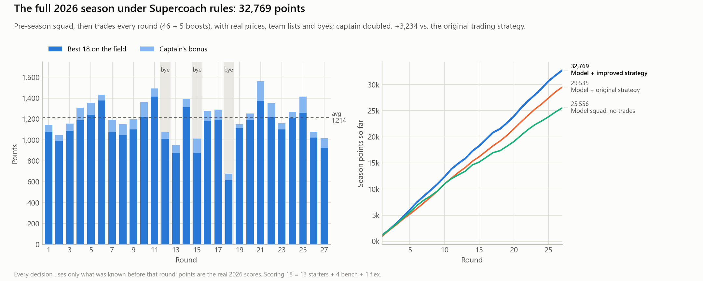

## Results at a glance

| | |
|---|---|
| **Full 2026 season, game rules** | **29,269 points**, an average of 1,084 a round. That is 1,186 more than the same rules driven by season averages, and 4,004 more than never trading |
| **Against real coaches** | Beats the **average 2026 coach** (28,765) and my own real team (27,956). Still well short of the top 10% of coaches (35,357 on average) and the winner (37,196) |
| **Team value** | Grew from $11.95M to **$13.56M** through 46 trades and 5 boosts |
| **Points predictor** | Trained on 2022–2025, then predicted all **6,407 games of 2026** before each was played. Average error was **17.0 pts per game**, vs 18.1 for the season-average heuristic, and R² rose from 0.15 to 0.24 |
| **Per player** | Each regular's average prediction correlates **0.89** with what they actually averaged |
| **Engineering** | Leak-proof features, Wide & Deep network, CBC integer programs, 45 unit tests, GitHub Actions CI |

## How it works

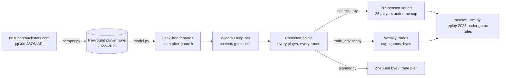

1. **Scrape** ([scraper.py](scraper.py)). The site's stats table is served by a jqGrid JSON endpoint. Each row is one player-round, with the score, minutes and about 80 stat fields. The scraper uses rotating user-agents, jittered delays and exponential backoff, and caches finished seasons.
2. **Predict** ([model.py](model.py)). For each game a player has played, the pipeline builds their state from earlier games only:
   - form and volatility
   - minutes, and whether they started or came off the bench
   - how their points are scored
   - price and break-even
   - last season's average
   - how generous the next opponent is to their position, and how strong their own team is

   A Keras **Wide & Deep** network predicts the next game's score from that state. [Tests](tests/test_no_target_leak.py) prove that changing a future score never changes an earlier feature.
3. **Pick a squad** ([optimizer.py](optimizer.py)). A PuLP/CBC integer program chooses 26 players, maximising the predicted points of the 18 who score. Constraints: the salary cap, Supercoach's position quotas, dual-position eligibility, at most 5 players per club, and backup cover at every starting position.
4. **Trade and plan** ([trade_advisor.py](trade_advisor.py), [planner.py](planner.py)).
   - **Trade advisor:** ranks every cap-legal, quota-legal trade by predicted points gained over the next 3 rounds, counting byes, and flags State of Origin risk.
   - **Planner:** schedules trades around the big bye rounds.
5. **Replay the season** ([season_sim.py](season_sim.py)). Plays a finished season under the game's rules using only information available before each round (details below).

## 1. The full 2026 season, played by the system

The simulation plays 2026 the way a human coach would:

- **Pre-season.** 26 players at start-of-season prices under the $11.95M cap. Round-1 team lists are public before lockout, so players not named are treated as unavailable.
- **Every round:**
  - **Prices** move exactly as they did in 2026.
  - **Trades:** up to 2 (3 in the big bye rounds 12, 15 and 18), 46 for the season, plus 5 one-off boosts. Each trade must fit the bank and the position quotas, and is chosen by predicted points gained over the next 3 rounds.
  - **Lineup:** the scoring 18 (13 starters, 4 bench, 1 flex) comes from players named that round, by predicted points. The highest prediction is captain, worth double.
  - **Scoring:** real 2026 points.
- **Comparisons.** The same rules driven by season averages (the most common heuristic), and the model's opening squad with no trades.

The chart at the top shows the result: **29,269 points**. The team-value chart below shows how trading turned a $11.95M squad into a $13.56M one.

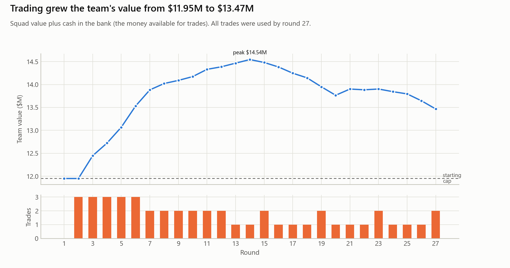

Every trade is logged in [`season_simulation_trades.csv`](outputs/season_review/season_simulation_trades.csv), the round-by-round lineups and captains in [`season_simulation_rounds.csv`](outputs/season_review/season_simulation_rounds.csv), and the final squad in [`season_simulation_final_squad.csv`](outputs/season_review/season_simulation_final_squad.csv).

### How it ranks against real 2026 coaches

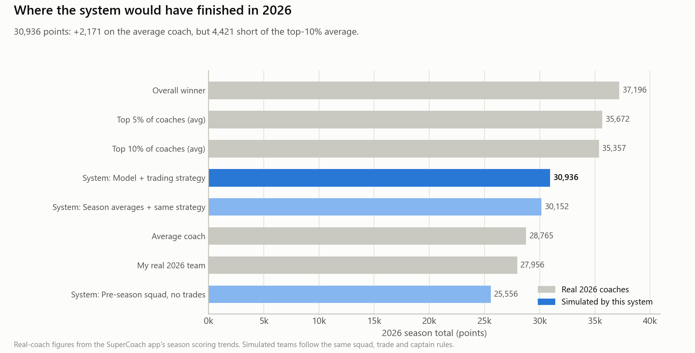

The real-coach figures come from the SuperCoach app's end-of-season scoring trends. The simulated team beats the average coach by 504 points and my own real 2026 team by 1,313. It is 6,088 points short of the top-10% average, roughly 226 points a round, and the round-by-round log shows where most of that goes:

- **Bye rounds, about 1,200 points.** In rounds 12, 15 and 18 it scored 2,190 in total, against its normal 1,128 a round. It doesn't plan ahead to field 18 players through the byes, which top coaches do.
- **Running out of trades, about 600 points.** All 46 trades were used by round 23, and the last four rounds averaged 997 against 1,157 earlier in the season.
- **Squad building, the remaining ~4,300.** The trade rule only chases predicted points over the next three rounds. It never deliberately buys cheap players to profit from their price rises, which is how top coaches afford a full team of premiums. It also sometimes sells a player and buys them back a round later.

The predictions are not the bottleneck. Section 3 shows they pick better teams than the alternatives. The next gains are in strategy: wiring in the bye planner ([planner.py](planner.py)), pacing trades across the season, and valuing future price rises.

## 2. Is the points predictor any good?

Everything above depends on the predicted points, so the predictor is tested on its own. I trained it on 2022–2025 only and asked it to predict all 6,407 games of 2026, each before it was played.

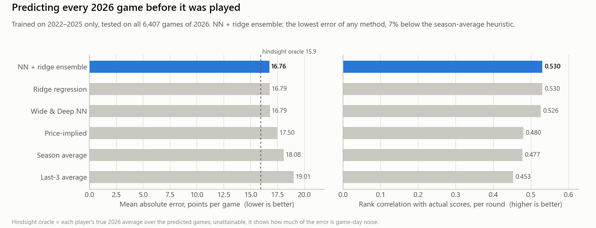

It beats the three heuristics a fantasy coach would use: season average, last-3 form, and the average implied by price. It also ranks players better within each round, which is what squad selection needs. It is level with a ridge regression. Deeper networks, other losses, ensembles and extra features all landed within ±0.1 points of error. Even a *hindsight oracle* that knows each player's true 2026 average misses by 15.9 points per game, so most of the remaining error is game-day randomness.

<p float="left">
  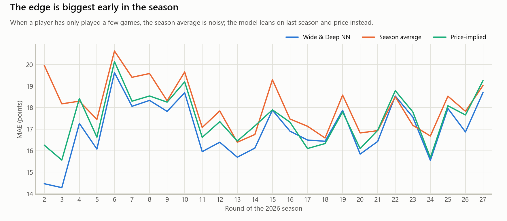
  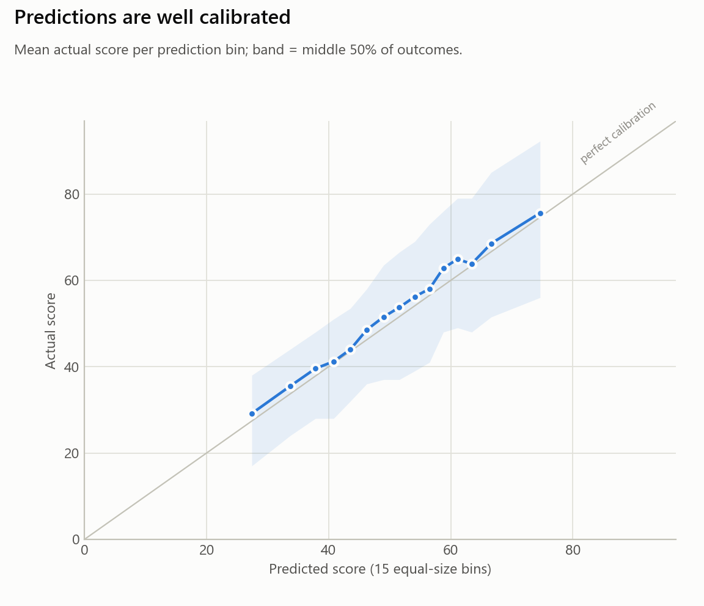
</p>

The edge is largest early in the season, when a three-game average is unreliable and the model leans on last season and price. The predictions are also well calibrated: when it predicts 60, players average about 60.

**Predicted vs actual for every player.** Each dot is one player's 2026 season: what the model predicted for them on average, against what they actually averaged.

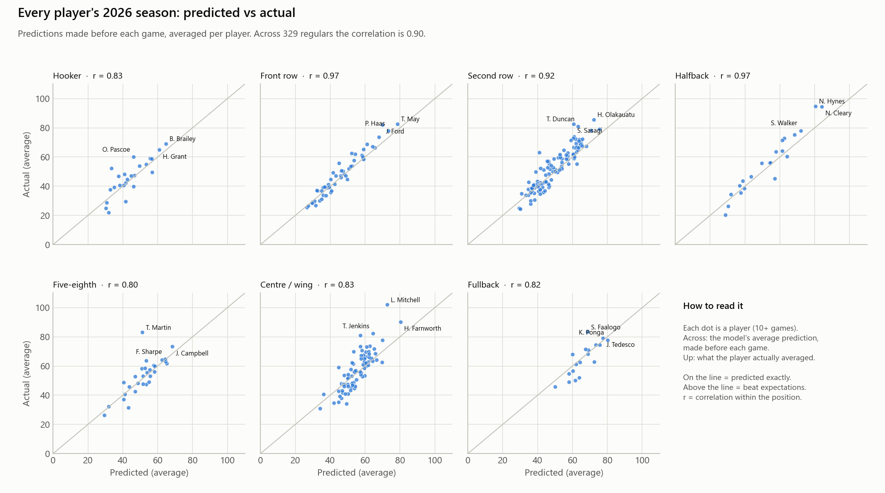

**Position analysis.** How each position scored, and how accurate the predictions were at each position compared with the season-average heuristic.

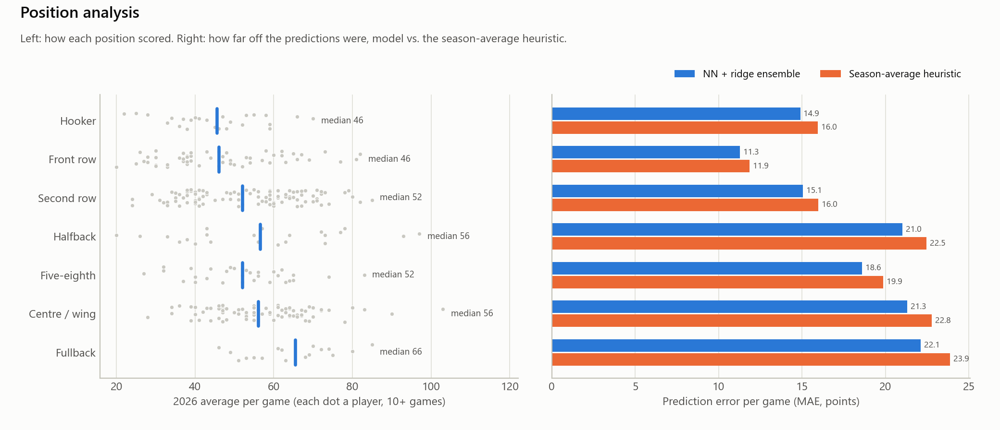

## 3. Which predictor picks better teams?

> **This is a controlled experiment, not a game simulation.** Real Supercoach only allows a couple of trades a round (that's section 1). Here, every round each method picks a **brand-new squad** from scratch. Squad history and trade limits are removed, so the only difference between the teams is how each method values players.

For each of the 27 rounds, three methods (the model, the season average, and price alone) each picked the best 26-man squad under the cap from the players named that round, at that round's prices. Each squad was scored by its best 18 on real results.

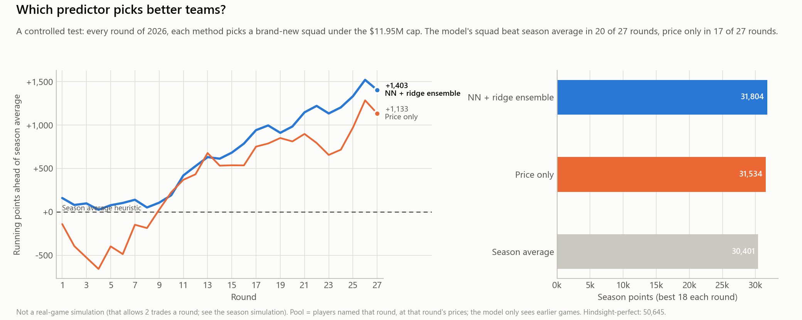

With the same optimizer and only the player valuations changed, the model's squads scored 32,086, against 31,534 for price alone and 30,401 for season averages. They beat price-only picks in 18 of 27 rounds and season-average picks in 21 of 27. Better predictions turn into better teams.

## 4. 2026 in hindsight

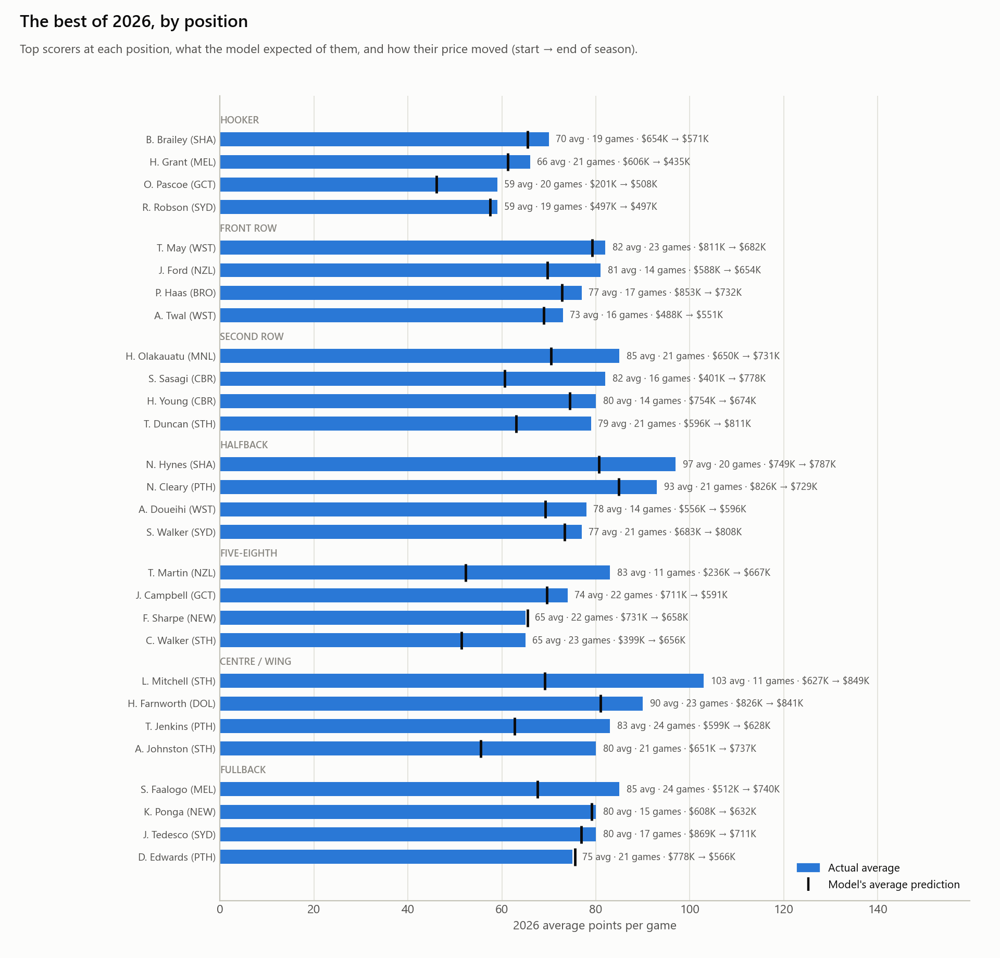

Feeding the optimizer the *actual* 2026 points gives the best squad money could have bought at start-of-season prices:

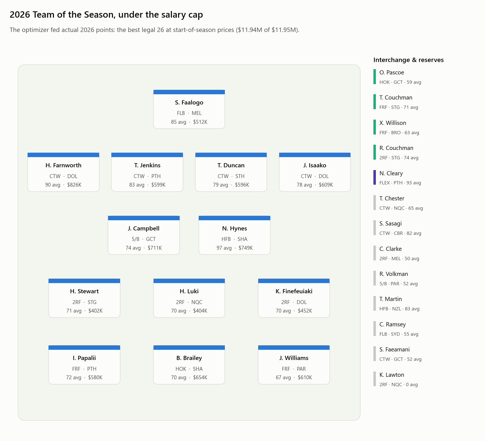

Below, the bargains: the players whose output was far above what their price implied, the "cash cows" that fund a winning team.

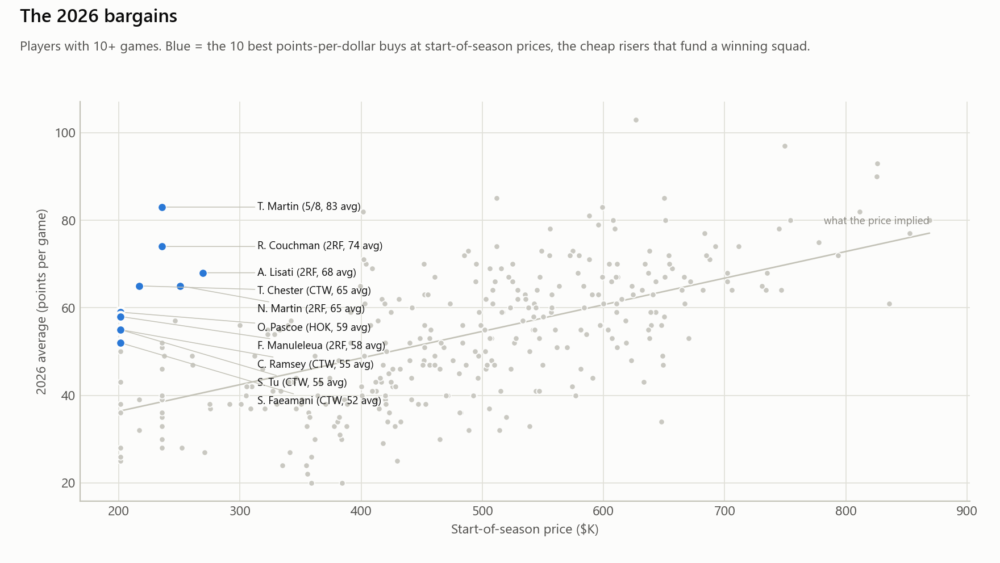

## What I learned

- **My first model was cheating, and catching it was the most valuable part of the project.** It predicted a player's season average from stats that included the five scoring components of that same average (base, attack, create, evade, negative). Those components add up to the answer, so it showed R² = 0.98 without forecasting anything. I rebuilt it as a strict "past games → next game" problem. R² dropped to an honest 0.24, but that model holds up on games it has never seen.
- **On noisy tabular data a linear model is a serious baseline.** A plain neural network lost to ridge regression, and a Wide & Deep design matched it. Reporting the tie is more useful than tuning on the test set until the network wins.
- **Good predictions are necessary but not sufficient.** The predictor beats every heuristic and the simulated team beats the average coach, but the best humans win on long-term planning: byes, trade pacing and cash generation. A three-round greedy trader can't see far enough ahead for that.
- **The market is efficient pre-season; the edge comes in-season.** Before round 1, the model's valuations and Supercoach's own prices rank players about equally well (r = 0.64 vs 0.63 against final averages). Once real form data arrives, the model pulls ahead.
- **Evaluation design matters as much as the model.** A single pre-season squad is one noisy sample, so I tested the predictor with 27 independent picks and then the full season under real rules. The optimizer's team-diversity bonus suits season-long squads but is the wrong objective for a one-off pick. Getting these right changed the conclusions more than any hyperparameter did.

## Run it

```bash
pip install -r requirements.txt

python season_review.py     # the final run: tests, simulation, all charts, retrains the model
python main.py --round 10   # replay any round: predictions + optimal squad (+ --plan for byes)
python trade_advisor.py --round 9 --no-scrape   # trade advice for the squad in data/inputs/round_9.yaml
python -m pytest -q         # 45 tests, no TensorFlow needed
```

## Repository layout

```
├── scraper.py          # jqGrid JSON API → data/raw/nrl_data_<year>.csv
├── model.py            # leak-free features, Wide & Deep network, holdout evaluation
├── optimizer.py        # PuLP/CBC squad integer program
├── trade_advisor.py    # weekly trade recommendations + trade map
├── planner.py          # 27-round bye / trade-scheduling simulation
├── season_sim.py       # replays a season under Supercoach rules
├── season_review.py    # end-of-season evaluation (the final run)
├── visualise.py        # every chart, one consistent style
├── main.py             # weekly pipeline CLI
├── data/
│   ├── raw/            # one CSV per season (2022–2026) + 2026 fixtures
│   └── inputs/         # weekly squad/starter YAML, injury list
├── models/             # next_game_model.keras + model_card.json
├── outputs/
│   ├── season_review/  # simulation logs, predictions, benchmarks, summary.json
│   └── live_2026/      # what the system produced live during the 2026 season
├── docs/images/        # figures in this README
└── tests/              # 45 pytest tests (leakage, simulator, optimizer, trades, quotas)
```

During the season, a scheduled GitHub Actions workflow ran the pipeline every Wednesday and published the squad and trade advice. It has been retired now the season is over, and CI runs the test suite on every push instead.

## Disclaimer

This project uses public data from `nrlsupercoachstats.com`. Please respect the site's terms and keep request volume polite. It is not affiliated with the NRL, News Corp or the Supercoach product.

Licensed under the [Apache License 2.0](LICENSE).
