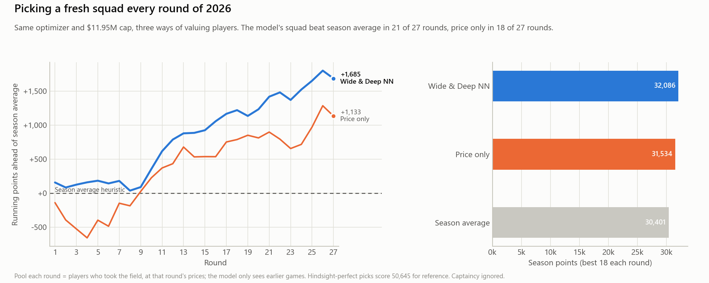
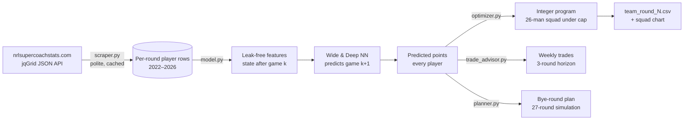

# NRL Supercoach Optimizer

[](https://github.com/M-Attwood/NRL-Super-Team-Stats/actions/workflows/tests.yml)


An end-to-end machine-learning system for **NRL Supercoach**, the rugby league fantasy game. It scrapes player statistics, predicts every player's next-game score with a neural network, and picks the best 26-man squad under the $11.95M salary cap with integer linear programming. It also plans trades around bye rounds.

I ran it live during the 2026 season. This repository is the final, end-of-season version: the code is cleaned up, the model is evaluated honestly on the full 2026 season, and each strategy is backtested against what actually happened.



## Results at a glance

| | |
|---|---|
| **Data** | 31,691 player-games from 2022–2026, scraped from a jqGrid JSON API |
| **Honest test** | Trained on 2022–2025 only, then predicted all **6,407 games of 2026** before each was played |
| **Prediction error** | **17.0 pts MAE**, vs 18.1 for the season-average heuristic (−6%). R² rises from 0.15 to 0.24 (+60%) |
| **Headroom used** | Closes **half the gap** between that heuristic and a hindsight oracle that knows each player's true average |
| **Squad selection** | Picking a fresh squad each round, the model's squads scored **32,086 pts**. That beat price-only picks (31,534) in 18 of 27 rounds and season-average picks (30,401) in 21 of 27 |
| **Engineering** | Leak-proof feature pipeline, Wide & Deep network, CBC integer program, 42 unit tests, GitHub Actions CI |

## How it works



1. **Scrape** ([scraper.py](scraper.py)). The site's stats table is served by a jqGrid JSON endpoint, not HTML. Each row is one player-round, with that round's score, minutes and roughly 80 stat fields, plus a season "Totals" row. Requests use rotating user-agents, jittered delays and exponential backoff, and finished seasons are cached in `data/raw/`.
2. **Features** ([model.py](model.py)). For each game *k* a player has played, the pipeline builds the player's state from games 1..k only:
   - form (season average, last 1/3/5, volatility)
   - opportunity (minutes; starting vs bench jersey)
   - how the points are scored (base, attack, playmaking and evasion averages; tackles, line breaks and so on)
   - market signals (price, break-even, price change)
   - last season's average
   - two context ratios, computed only from earlier rounds: how many points the next opponent has conceded to this position, and how strong the player's own team is

   The target is the score in game *k+1*. [Tests](tests/test_no_target_leak.py) assert that changing a future score never changes an earlier feature.
3. **Model**. A Keras **Wide & Deep** network. A linear "wide" path sits alongside a two-layer ReLU "deep" path with dropout and L2. The deep path starts at zero, so training begins at the linear solution and only moves away where the data supports it. Inputs are standardised by a `Normalization` layer inside the model, so the saved `.keras` file is self-contained.
4. **Optimize** ([optimizer.py](optimizer.py)). A PuLP/CBC integer program chooses 26 players, maximising the predicted points of the scoring 18. Constraints:
   - the salary cap
   - Supercoach's position quotas (2 HOK, 4 FRF, 6 2RF, 2 HFB, 2 5/8, 7 CTW, 2 FLB + 1 FLEX), with dual-position players filling exactly one slot
   - at most 5 players per club
   - injury cover: every starting position has an eligible backup

   For season-long squads, a team-diversity bonus and a positional-versatility bonus hedge bye and injury risk.
5. **Advise** ([trade_advisor.py](trade_advisor.py), [planner.py](planner.py)). Each week the trade advisor compared my real squad (from `data/inputs/round_N.yaml`) with the ideal squad built from confirmed starters. It ranked cap-legal, quota-legal trades by predicted gain over a 3-round horizon, flagged byes and State of Origin risk, and drew a trade map. The planner simulates all 27 rounds to schedule trades around the three big bye rounds.

## Results

### 1. Predicting every 2026 game before it was played


The network beats every heuristic a fantasy coach would use: season average, last-3 form, and the price-implied average. It ranks players better within each round, which is what squad selection actually needs. It is **level with a ridge regression**. I tried deeper MLPs, MSE vs Huber vs MAE losses, five-seed ensembles and extra features. All of them landed within ±0.1 MAE, so the remaining error is game-day noise rather than model capacity. The *hindsight oracle* (each player's true 2026 average) still misses by 15.9 points per game.

<p float="left">
  
  
</p>

The edge is largest early in the season. A three-game average is noisy, so the model leans on last season and price. Predictions are also well calibrated: a predicted 60 really does average about 60.

### 2. Does better prediction pick better squads?

Every round of 2026, each strategy picked a fresh 26-man squad under the cap from the players who took the field, at that round's prices. Each squad was then scored by its best legal 18 on real results (chart at the top). Using the same optimizer and only changing the player valuations, the model finished **+1,685 pts ahead of the season-average heuristic** and **+552 ahead of price-only**. The hindsight-perfect picks (50,645) show how much luck is left in the game.

### 3. 2026 in hindsight


Feeding the optimizer the *actual* 2026 points gives the best legal squad money could have bought at start-of-season prices. Below, the bargains: players whose output was far above what their price implied.


## What I learned

- **My first model had target leakage, and finding it was the most valuable part of the project.** The original version predicted a player's season average from that same season's scoring components, which sum to the average. Validation R² was 0.98, which looked too good to be true, and it was. Rebuilding it as a strict "past games → next game" problem dropped R² to an honest 0.24, and that model actually holds up out of sample.
- **On noisy tabular data a linear model is a serious baseline.** A plain MLP lost to ridge regression, and the Wide & Deep architecture matched it. Reporting that tie is more useful than tuning on the test set until the network wins.
- **Pre-season, the market is efficient.** The model's pre-season valuations correlate with players' final 2026 averages about as well as Supercoach's own prices do (r = 0.64 vs 0.63). In a single set-and-forget pre-season pick, a price-only squad outscored the model's squad, because several of the model's $200K bench rookies barely played (0–2 games). The network can only value an unseen rookie from price, and it can't know who will get game time. The model's edge comes in-season, once it has form data.
- **Evaluation design matters as much as the model.** One season-long squad is a single noisy sample, while 27 independent weekly picks are not. The live optimizer's diversity bonus also turned out to be the wrong objective for a one-round pick, because it can override 30-point valuation differences. Getting the backtest right changed the conclusions more than any hyperparameter did.

## Run it

```bash
pip install -r requirements.txt

python season_review.py     # the final run: benchmark, backtests, charts, retrains the model
python main.py --round 10   # replay any round: predictions + optimal squad (+ --plan for byes)
python trade_advisor.py --round 9 --no-scrape   # trade advice for the squad in data/inputs/round_9.yaml
python -m pytest -q         # 42 tests, no TensorFlow needed
```

`main.py` scrapes the live season unless `--no-scrape` is passed. Once round 27 is complete, it tells you to run the season review instead.

## Repository layout

```
├── scraper.py          # jqGrid JSON API → data/raw/nrl_data_<year>.csv
├── model.py            # leak-free features, Wide & Deep network, holdout evaluation
├── optimizer.py        # PuLP/CBC squad integer program
├── trade_advisor.py    # weekly trade recommendations + trade map
├── planner.py          # 27-round bye / trade-scheduling simulation
├── season_review.py    # end-of-season benchmark and backtests (the final run)
├── visualise.py        # every chart, one consistent style
├── main.py             # weekly pipeline CLI
├── data/
│   ├── raw/            # one CSV per season (2022–2026) + 2026 fixtures
│   └── inputs/         # weekly squad/starter YAML, injury list
├── models/             # next_game_model.keras + model_card.json (features, metrics)
├── outputs/
│   ├── season_review/  # benchmark, per-game predictions, backtests, summary.json
│   └── live_2026/      # what the system produced live during the 2026 season
├── docs/images/        # figures in this README
└── tests/              # 42 pytest tests (leakage, optimizer, trades, quotas, matching)
```

During the season, a scheduled GitHub Actions workflow ran the pipeline every Wednesday and published the squad and trade advice. It has been retired now the season is over, and CI runs the test suite on every push instead.

## Disclaimer

This project uses public data from `nrlsupercoachstats.com`. Please respect the site's terms and keep request volume polite: the scraper's delays and backoff exist for that reason. It is not affiliated with the NRL, News Corp or the Supercoach product.

Licensed under the [Apache License 2.0](LICENSE).
