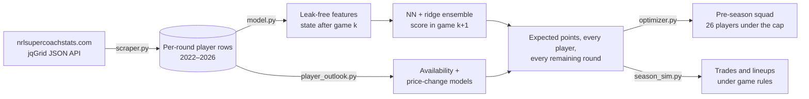
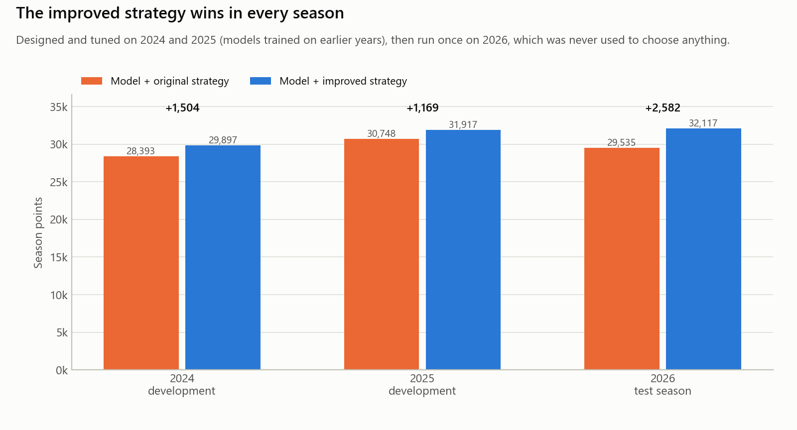

# NRL Supercoach Optimizer

[](https://github.com/M-Attwood/NRL-Super-Team-Stats/actions/workflows/tests.yml)


An end-to-end machine-learning system that plays **NRL Supercoach**, the rugby league fantasy game, from start to finish:

- it picks a 26-man squad under the $11.95M salary cap before round 1
- each week it predicts every player's score, whether they'll be picked, and how their price will move
- it trades within the game's rules to adapt through the season

It scrapes player statistics, predicts scores with a TensorFlow network averaged with a ridge regression, and makes its selections with integer linear programming.

I ran it live during the 2026 season. This repository is the final version: the code is cleaned up, the trading strategy has been rebuilt, and whole seasons are replayed under the game's rules to show what the system would have scored.


## Results at a glance

| | |
|---|---|
| **Full 2026 season, game rules** | **33,268 points**, an average of 1,232 a round. That's 3,733 more than the original trading strategy and 7,712 more than never trading |
| **Against real coaches** | Beats the **average 2026 coach by 4,503** and my own real team by 5,312. It finishes 2,089 short of the top-10% average (35,357); the winner scored 37,196 |
| **Honest testing** | Every strategy setting was tuned on the 2024 and 2025 seasons only; 2026 is held out as the test season. The improved strategy wins in all three seasons |
| **Points predictor** | Trained on 2022–2025, then predicted all **6,407 games of 2026** before each was played. Average error was **16.97 pts per game**, vs 18.08 for the season-average heuristic, and R² rose from 0.15 to 0.24 |
| **Supporting models** | Availability (will the player be named, State of Origin included?) AUC **0.90**; a 3-game price-change forecast |
| **Engineering** | Leak-proof features, Wide & Deep network, gradient-boosted trees, CBC integer programs, 56 unit tests, GitHub Actions CI |

## How it works



1. **Scrape** ([scraper.py](scraper.py)). The site's stats table is served by a jqGrid JSON endpoint. Each row is one player-round, with the score, minutes and about 80 stat fields. The scraper is polite (rotating user-agents, jittered delays, exponential backoff) and caches finished seasons.
2. **Predict scores** ([model.py](model.py)). For each game a player has played, the pipeline builds their state from earlier games only:
   - form and volatility
   - minutes, and whether they started or came off the bench
   - how their points are scored
   - price and break-even
   - last season's average
   - how generous the next opponent is to their position, and how strong their own team is

   A Keras **Wide & Deep** network and a ridge regression each predict the next game's score from that state, and the system uses their average. [Tests](tests/test_no_target_leak.py) prove that changing a future score never changes an earlier feature.
3. **Predict availability and price** ([player_outlook.py](player_outlook.py)). Gradient-boosted trees estimate:
   - **availability:** the chance a player is named for their team's next game, from recent games, minutes, role, how many games in a row they've missed, and State of Origin. Origin weeks are read from the draw (the rounds where 5+ teams have the bye). Origin selection is inferred from the data: players who sat out their club's game in an Origin week right after playing the week before, this season or last
   - **price change:** how much their price will move over the next three games (Supercoach prices react to scores against the break-even)
4. **Pick a squad** ([optimizer.py](optimizer.py)). A PuLP/CBC integer program chooses 26 players, maximising the predicted points of the 18 who score. Constraints: the salary cap, Supercoach's position quotas, dual-position eligibility, at most 5 players per club, and backup cover at every starting position.
5. **Trade through the season** ([season_sim.py](season_sim.py)). Each round, it scores every legal trade by how much it improves the squad's expected best 18 (plus captain) across *all* remaining rounds (details below).

## 1. The full 2026 season, played by the system

The simulation plays a season the way a human coach would, using only information available before each round:

- **Pre-season.** 26 players at start-of-season prices under the $11.95M cap.
- **Every round:**
  - **Prices** move exactly as they did that season.
  - **Trades:** up to 2 (3 in the big bye rounds, read from each season's draw: 12, 15 and 18 in 2026), 46 for the season, plus 5 one-off boosts. Every trade must fit the bank and the position quotas.
  - **Lineup:** the scoring 18 (13 starters, 4 bench, 1 flex) comes from players named that round. The highest prediction is captain, worth double.
  - **Scoring:** the real points from that round.

### How the trading strategy was improved

The first version judged trades one player at a time, on predicted points over the next 3 rounds. It finished an average coach. The rebuilt strategy:

- **Looks to the end of the season.** Each trade is valued over every remaining round, with each further round weighted 10% less, using a separate prediction for each upcoming opponent.
- **Values the whole squad.** It computes the squad's best 18 plus captain in every future round, so depth for bye rounds and injuries counts automatically.
- **Knows who will play.** The availability model replaces "if they weren't named, assume they're out", and it expects Origin players to miss club games in Origin weeks.
- **Values cash.** Money freed up and expected price rises count as future points.
- **Paces its trades.** It keeps 1.5 trades in hand for every round still to play, and the full 3 for each big bye round still to come. Injuries and late-season rests can still be covered in the final rounds, and the bye rounds get all three of their trades. The first version spent every trade as soon as it looked worthwhile and was out of trades after round 23.
- **Stops churn.** No buying back a player sold in the last 3 rounds.

To avoid fitting the season being reported, **every design choice and setting was made on the 2024 and 2025 seasons**, with all models trained only on earlier years. 2026 is held out as the test season:



What each part contributes, averaged over the two development seasons (2026 not used):

| Change, starting from the improved strategy | Average season | Effect |
|---|---:|---:|
| Improved strategy | 31,366 | |
| Only look 3 rounds ahead | 22,834 | −8,532 |
| Value trades one player at a time instead of the whole squad | 30,127 | −1,239 |
| Ignore cash and price rises | 30,137 | −1,229 |
| Allow immediate buy-backs | 30,819 | −547 |
| Spend trades as soon as they look worthwhile (no reserve) | 31,427 | +61 |
| Drop the availability model | 31,769 | +403 |

Looking ahead, valuing the whole squad and valuing cash do the heavy lifting. One different trade changes everything after it, so a single replay moves by a few hundred points from small changes. Effects under about 500 are within that noise.

**Pacing trades is a trade-off, not a free win.** To check the reserve was real and not luck, I replayed each development season 6 times with small changes to the strategy. Keeping trades in hand added about 430 points a season over the last five rounds and removed the empty spots there. It cost about 150 in rounds 12–22, when trades were rationed. Overall it gained about 285 a season and beat spending freely in 9 of the 12 replays. Smaller reserves (0.5–1.25 trades a round) did slightly worse than no reserve. I only looked at trade pacing after spotting in the 2026 log that trades ran out in round 23. The setting itself was chosen on 2024–25, and 2026 was then re-run. That check came before the Origin and bye-round changes below. With them, a single replay at the default settings puts no reserve 61 points ahead, which is within the noise.

**State of Origin and the big bye rounds.** The 2026 log also showed the reserve rationing the big bye rounds: round 18 got one trade and scored 678 with 5 empty spots. Two changes followed. Both were chosen on 2024–25 and checked over the same 12 perturbed replays before 2026 was re-run once:

- **The availability model learned State of Origin.** On the development seasons its log-loss improved from 0.411 to 0.409 (2024) and from 0.392 to 0.382 (2025). In Origin weeks alone it improved from 0.479 to 0.468 and from 0.504 to 0.453.
- **The reserve now saves each bye round's full 3 trades in advance**, instead of rationing them in the round itself. Letting a bye round simply overspend the reserve did worse, with or without the Origin features.

Together they added 406 points a season over the previous version and won 7 of the 12 replays, but the gain all came from 2025 (+1,294, 6 of 6). 2024 lost 482 (1 of 6). Pricing in Origin makes the strategy prefer Origin players whose clubs have the bye in Origin weeks anyway, since those players lose nothing extra. In one 2024 replay that put 17 of the 26 squad players on teams with the bye in round 16. While doing this I also found the simulator had been giving 2024 its three-trade rounds in 2026's bye rounds (12, 15 and 18 instead of 13, 16 and 19). It now reads them from each season's draw, and the comparison above uses the corrected 2024. In 2026 the changes lifted the season from 32,769 to 33,268 points, and the three bye rounds from 2,765 to 3,187 (round 18: 678 to 1,030).

The availability model is accurate (AUC 0.90), but its effect on season totals is mixed. Switching it off entirely would have scored 314 more a season over the 12 development replays (8 of 12), and again the seasons disagree: +1,278 in 2024, −651 in 2025. I kept it because it's the principled approach and the split looks season-specific. I report the result rather than switching it off after seeing 2026.

The team-value chart shows the strategy now buys premiums. 12 of its 51 trades bought a $650K+ player, against 7 for the original strategy, and trades are spread evenly to the final round.


Every trade is logged in [`season_simulation_trades.csv`](outputs/season_review/season_simulation_trades.csv), the round-by-round lineups and captains in [`season_simulation_rounds.csv`](outputs/season_review/season_simulation_rounds.csv), and the final squad in [`season_simulation_final_squad.csv`](outputs/season_review/season_simulation_final_squad.csv).

### How it ranks against real 2026 coaches


The real-coach figures come from the SuperCoach app's end-of-season scoring trends. The simulated team beats the average coach by 4,503 points; the original strategy beat them by 770. It is 2,089 short of the top-10% average, about 77 points a round:

- **Bye rounds, about 570 points.** It scored 3,187 across rounds 12, 15 and 18, against a normal 1,253 a round. All three trades went in each bye round, but round 15 still had six empty spots.
- **The rest, about 1,500:** stronger squads and sharper captaincy from the best coaches.

**Does the model matter, or just the strategy?** The same improved strategy run on plain season averages, instead of the model's predictions, scored 32,679 in 2026, 589 behind. The model also won both development seasons, by 2,383 and 3,304. In an earlier version, without the trade reserve, season averages edged the model in 2026 alone. A single season is a noisy test, which is why all three are reported.

## 2. Is the points predictor any good?

Everything above depends on the predicted points, so the predictor is also tested on its own. Trained on 2022–2025 only, it predicted all 6,407 games of 2026, each before it was played.


It beats every heuristic a fantasy coach would use: season average, last-3 form, and the average implied by price. Averaging the network with a ridge regression gives the lowest error of any method. That ensemble was adopted because it beat the network alone on both development seasons, not on 2026. Deeper networks, other losses and extra features all landed within ±0.1 points. Even a *hindsight oracle* that knows each player's true 2026 average misses by 15.9 points per game, so most of the remaining error is game-day randomness.

<p float="left">
  
  
</p>

The edge is largest early in the season, when a three-game average is unreliable and the model leans on last season and price. The predictions are also well calibrated: when it predicts 60, players average about 60.

**Predicted vs actual for every player.** Each dot is one player's 2026 season: the model's average prediction for them against what they actually averaged (correlation 0.90 across 329 regulars).


**Position analysis.** How each position scored, and how accurate the predictions were at each position compared with the season-average heuristic.


## 3. Which predictor picks better teams?

> **This is a controlled experiment, not a game simulation.** Real Supercoach only allows a couple of trades a round (that's section 1). Here, every round each method picks a **brand-new squad** from scratch. Squad history and trade limits are removed, so the only difference between the teams is how each method values players.

For each of the 27 rounds of 2026, three methods (the model, the season average, and price alone) each picked the best 26-man squad under the cap from the players named that round, at that round's prices. Each squad was scored by its best 18 on real results.


The model's squads scored 31,804, against 31,534 for price alone and 30,401 for season averages. They beat price-only picks in 17 of 27 rounds and season-average picks in 20 of 27.

## 4. 2026 in hindsight


Feeding the optimizer the *actual* 2026 points gives the best squad money could have bought at start-of-season prices:


Below, the bargains: the players whose output was far above what their price implied, the "cash cows" that fund a winning team.


## What I learned

- **My first model was cheating, and catching it was the most valuable part of the project.** It predicted a player's season average from stats that included the five scoring components of that same average (base, attack, create, evade, negative). Those components add up to the answer, so it showed R² = 0.98 without forecasting anything. I rebuilt it as a strict "past games → next game" problem. R² dropped to an honest 0.24, but that model holds up on games it has never seen.
- **Strategy mattered more than prediction accuracy.** With the same predictions, the rebuilt trading strategy added about 3,700 points in 2026. Every tweak to the predictor itself moved error by less than 0.1 points.
- **Keep a test set you never touch.** Strategy settings were chosen on 2024–2025, never on 2026. When the 2026 log showed flaws (trades running out in round 23, then a round-18 bye with a single trade), each fix was designed and tuned on 2024–25 before 2026 was re-run. Those extra looks at 2026 are disclosed rather than hidden.
- **Replays of a season are noisy.** One different trade changes everything after it, so I check that an improvement holds across perturbed replays before trusting it.
- **On noisy tabular data a linear model is a serious baseline.** A plain neural network lost to ridge regression; Wide & Deep matched it, and averaging the two was best.
- **The market is efficient pre-season.** Before round 1, the model and Supercoach's own prices rank players equally well against final averages (r = 0.63 each). The edge comes in-season, once real form data arrives.

## Run it

```bash
pip install -r requirements.txt

python season_review.py     # the final run: benchmarks, 2024-26 season replays, all charts, retrains the model
python main.py --round 10   # replay any round: predictions + optimal squad (+ --plan for byes)
python trade_advisor.py --round 9 --no-scrape   # trade advice for the squad in data/inputs/round_9.yaml
python -m pytest -q         # 56 tests, no TensorFlow needed
```

## Repository layout

```
├── scraper.py          # jqGrid JSON API → data/raw/nrl_data_<year>.csv
├── model.py            # leak-free features, Wide & Deep + ridge ensemble, holdout evaluation
├── player_outlook.py   # availability (incl. State of Origin) and price-change models
├── optimizer.py        # PuLP/CBC squad integer program
├── season_sim.py       # replays a season under Supercoach rules (original + improved strategy)
├── season_review.py    # end-of-season evaluation (the final run)
├── trade_advisor.py    # weekly trade recommendations used live in 2026
├── planner.py          # 27-round bye / trade-scheduling simulation
├── visualise.py        # every chart, one consistent style
├── main.py             # weekly pipeline CLI
├── data/
│   ├── raw/            # one CSV per season (2022–2026) + 2026 fixtures
│   └── inputs/         # weekly squad/starter YAML, injury list, real-coach benchmarks
├── models/             # next_game_model.keras + model_card.json (incl. ridge weights)
├── outputs/
│   ├── season_review/  # simulation logs, predictions, benchmarks, summary.json
│   └── live_2026/      # what the system produced live during the 2026 season
├── docs/images/        # figures in this README
└── tests/              # 56 pytest tests (leakage, simulator, availability, optimizer, trades)
```

During the season, a scheduled GitHub Actions workflow ran the pipeline every Wednesday and published the squad and trade advice. It has been retired now the season is over, and CI runs the test suite on every push instead.

## Disclaimer

This project uses public data from `nrlsupercoachstats.com`. Please respect the site's terms and keep request volume polite. It is not affiliated with the NRL, News Corp or the Supercoach product.

Licensed under the [Apache License 2.0](LICENSE).
