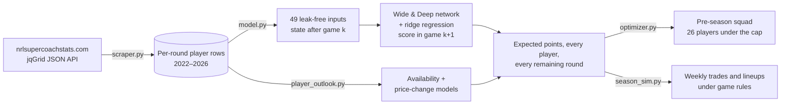
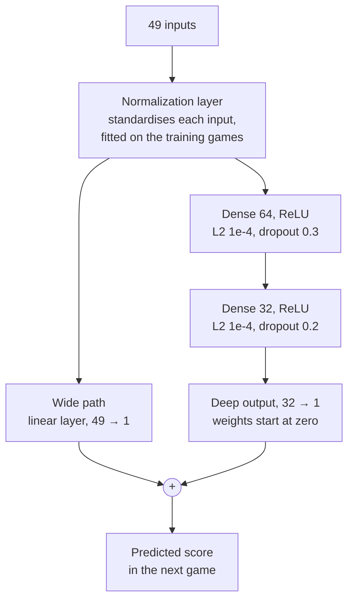

# NRL Supercoach Optimizer

[](https://github.com/M-Attwood/NRL-Super-Team-Stats/actions/workflows/tests.yml)


An end-to-end machine-learning system that plays **NRL Supercoach**, the rugby league fantasy game, for a whole season:

- a **TensorFlow Wide & Deep neural network** predicts every player's score in their next game
- gradient-boosted trees predict whether each player will be picked and how their price will move
- integer linear programming picks a 26-man squad under the $11.95M salary cap
- a trading strategy adapts the squad every week within the game's rules

I ran it live during the 2026 season. This repository is the final version: the code is cleaned up, and the whole 2026 season is replayed under the game's rules to show what the system would have scored.


## Results at a glance

| | |
|---|---|
| **Neural network** | Wide & Deep network with 49 inputs and 5,363 trained weights. Trained on 25,284 games (2022–2025), then predicted all **6,407 games of 2026**, each before it was played |
| **Prediction accuracy** | Averaged with a ridge regression, average error was **16.97 points per game**, against 18.08 for the season-average heuristic coaches use. R² rose from 0.15 to 0.24 |
| **Full 2026 season, game rules** | **30,936 points**, an average of 1,146 a round, and 5,380 more than keeping the pre-season squad all year |
| **Against real coaches** | Beats the **average 2026 coach by 2,171** and my own real team by 2,980. It finishes 4,421 short of the top-10% average (35,357); the winner scored 37,196 |
| **Honest testing** | Every model and strategy setting was chosen on the 2024 and 2025 seasons; 2026 is held out as the test season |
| **Engineering** | Leak-proof feature pipeline, Keras, scikit-learn gradient boosting, PuLP/CBC integer programs, 61 unit tests, GitHub Actions CI |

## How it works



1. **Scrape** ([scraper.py](scraper.py)). The site's stats table is served by a jqGrid JSON endpoint. Each row is one player-round, with the score, minutes and about 80 stat fields. The scraper is polite (rotating user-agents, jittered delays, exponential backoff) and caches finished seasons.
2. **Predict scores** ([model.py](model.py)). The neural network, described in depth below.
3. **Predict availability and price** ([player_outlook.py](player_outlook.py)). Gradient-boosted trees estimate:
   - **availability:** the chance a player is named for their team's next game (AUC 0.90). It uses recent games, minutes, role, games missed in a row, and State of Origin (Origin weeks are read from the draw; Origin players are inferred from club games they sat out in those weeks)
   - **price change:** how much a player's price will move over the next three games
4. **Pick a squad** ([optimizer.py](optimizer.py)). A PuLP/CBC integer program chooses 26 players to maximise the predicted points of the 18 who score. Constraints: the salary cap, Supercoach's position quotas, dual-position eligibility, at most 5 players per club, and backup cover at every starting position.
5. **Trade through the season** ([season_sim.py](season_sim.py)). Each round it scores every legal trade by how much it improves the squad's expected scoring side across all remaining rounds (section 4).

## 1. The neural network

### The prediction problem

For every game a player has played, the network sees their **state after that game**, built only from games up to and including it, and learns to predict their **score in their next game**:

```
state after game k (games 1..k only)   →   Supercoach score in game k+1
```

Every input is a running statistic that stops at game k. A [test](tests/test_no_target_leak.py) changes a future score and checks that no earlier input moves. This rule exists because my first model broke it (see [What I learned](#what-i-learned)).

The model that predicts 2026 learned from 25,284 such pairs from 2022–2025. The production model for next season is retrained on all 31,691, 2026 included.

### The 49 inputs

| Group | Inputs | What they capture |
|---|---:|---|
| Recent form | 6 | season average, last game, last-3 and last-5 averages, volatility, games played |
| Minutes and role | 7 | average, last-3 and last-game minutes, points per minute, started or came off the bench, share of games started |
| How points are scored | 19 | season averages of the five Supercoach scoring components (base, attack, create, evade, negative) and of 14 stats such as tackles, line breaks, tries, goals, hit-ups and errors |
| Price and break-even | 3 | current price, break-even, price change so far this season |
| Last season | 3 | last season's average and games played, and whether the player has a last season |
| Next opponent | 1 | points the opponent has conceded to this position so far, shrunk toward the league average |
| Own team | 1 | the team's points per game relative to the league |
| Round and days off | 2 | round number, rounds since the player's last game |
| Position | 7 | one flag per position; dual-position players get two |

### Architecture: Wide & Deep



The design follows Google's Wide & Deep model (Cheng et al., 2016):

- **The wide path** is a linear model on the standardised inputs, with its bias set to the average score.
- **The deep path** is a two-layer ReLU network that learns non-linear corrections and interactions.
- **The deep output starts at zero.** Training begins from a purely linear model, and the deep path only moves away from it where the data supports it. On a target this noisy (one game's score), that start keeps the network from fitting noise early.
- **Regularisation:** dropout (0.3, then 0.2) and L2 weight decay on both hidden layers.
- **The normalisation lives inside the model.** The saved model standardises its own inputs, so a prediction can't be served with mismatched scaling.

In total the network has 5,363 trained weights.

### Training

| | |
|---|---|
| Loss | Mean squared error, because the game rewards total points, so the network should predict the expected (mean) score |
| Optimiser | Adam, learning rate 1e-3, batch size 256 |
| Validation | 15% of **players** are held out of the fit. Splitting by player, not by game, means the stopping signal measures how well it predicts players it has never seen |
| Early stopping | Stops after 12 epochs without improvement on the held-out players and restores the best weights |
| Learning rate | Halved after 5 epochs without improvement (down to 1e-5) |
| Reproducibility | Fixed seed (42); the ridge weights are stored as plain numbers in [`model_card.json`](models/model_card.json), with no pickles |


The fit set's error keeps falling, but the held-out players' error flattens by about epoch 20. Early stopping keeps epoch 35, where the held-out error was lowest (17.48 points a game).

### How the architecture was chosen

Choices were made on the 2025 season (trained on 2022–2024, tested on every 2025 game), not on the season that is reported:

| Model (2025 season) | Trained weights | Error (pts/game) | R² | Rank correlation |
|---|---:|---:|---:|---:|
| Season average (the coaches' heuristic) | 0 | 17.88 | 0.109 | 0.440 |
| Plain neural network (64-32, no wide path) | 5,313 | 16.79 | 0.220 | 0.482 |
| Wide & Deep, 3 hidden layers (128-64-32) | 16,819 | 16.91 | 0.213 | 0.475 |
| Wide & Deep, Huber loss | 5,363 | 16.66 | 0.208 | 0.483 |
| **Wide & Deep (chosen)** | 5,363 | 16.75 | 0.221 | 0.482 |
| Ridge regression | 50 | 16.66 | 0.226 | 0.488 |
| **Wide & Deep + ridge, averaged (production)** | 5,413 | **16.65** | **0.227** | **0.488** |

What the comparison showed:

- **Adding the wide path helped slightly.** It beat the same network without it (16.75 vs 16.79), a gap about the size of seed-to-seed variation.
- **A bigger network was worse.** Three times the weights fitted more noise.
- **Huber loss lowered the average error but worsened R².** It pulls predictions toward the median score, and the game is won on expected points.
- **No network beat ridge regression on its own.** Retraining with three different seeds moved the error between 16.71 and 16.75, so differences that small are noise.
- **Averaging the network with ridge was best or tied-best on every measure.** The two models make different mistakes, and averaging cancels some of them. The production predictor is that average. Rookies with no games this season or last fall back to the price-implied estimate.

### What the network learned

To see what the network relies on, I shuffled one group of inputs at a time across every 2026 game and measured how much worse its predictions got (permutation importance):


The network gets most of its signal from **how a player's points are scored**, then price, then minutes. Ridge regression, on the same inputs, leans on price twice as heavily. The network reads the underlying stats more and the market price less. That's one reason averaging the two helps.

The deep path is doing real work inside the network. It adjusts each prediction by 6.8 points on average, and shifts 60% of predictions by more than 5 points. With the deep path removed, the wide path alone would err by 18.36 a game. The two paths are trained together, so the wide path relies on the deep path's corrections.

The same measurement split by phase of the season shows the network changing what it relies on as information arrives:


In the first rounds, with only a few games known, minutes and role count almost twice as much: who is starting and playing big minutes is the clearest early signal. Last season's average barely registers once any 2026 games exist.

## 2. How well it predicts 2026

Trained on 2022–2025 only, the predictor forecast all 6,407 games of 2026, each before it was played.


It beats every heuristic a fantasy coach would use: season average, last-3 form, and the average implied by price. Even a *hindsight oracle* that knows each player's true 2026 average misses by 15.9 points a game, so most of the remaining error is game-day randomness no model can remove.

<p float="left">
  
  
</p>

The edge over the season average is largest early in the season, when a three-game average is unreliable. The predictions are also well calibrated: when it predicts 60, players average about 60.

**Predicted vs actual for every player.** Each dot is one player's 2026 season: the model's average prediction for them against what they actually averaged (correlation 0.90 across 329 regulars).


**Position analysis.** How each position scored, and how accurate the predictions were at each position compared with the season-average heuristic.


## 3. Which predictor picks better teams?

> **This is a controlled experiment, not a game simulation.** Real Supercoach only allows a few trades a round (that's section 4). Here, every round each method picks a **brand-new squad** from scratch, so the only difference between the teams is how each method values players.

For each of the 27 rounds of 2026, three methods (the model, the season average, and price alone) each picked the best 26-man squad under the cap from the players named that round, at that round's prices. Each squad was scored by its best 18 on real results.


The model's squads scored 31,804, against 31,534 for price alone and 30,401 for season averages. They beat price-only picks in 17 of 27 rounds and season-average picks in 20 of 27.

## 4. The full 2026 season, played by the system

The simulation plays a season the way a human coach would, using only information available before each round:

- **Pre-season.** 26 players at start-of-season prices under the $11.95M cap.
- **Every round:**
  - **Prices** move exactly as they did that season.
  - **Trades:** up to 2 a round, and 4 in the big bye rounds (12, 15 and 18 in 2026), 46 for the season. Five boosts each allow one extra trade in a round, which still comes out of the 46. Every trade must fit the bank and the position quotas.
  - **Lineup:** the scoring 18 (13 starters, 4 bench, 1 flex) comes from players named that round. The highest prediction is captain, worth double.
  - **Scoring:** the real points from that round. In the big bye rounds only the best 13 count.

### The trading strategy

- **Looks to the end of the season.** Each trade is valued over every remaining round, each further round weighted 10% less, with a separate prediction against each upcoming opponent.
- **Values the whole squad.** It works out the squad's best 18 (best 13 in a big bye round) plus captain in every future round, so depth for byes and injuries counts automatically.
- **Knows who will play.** The availability model, including State of Origin, estimates who will be named in future rounds.
- **Values cash.** Money freed up and expected price rises count as future points.
- **Paces its trades.** It keeps 1.25 trades in hand for every round still to play, so it can still cover injuries in the final rounds.
- **Stops churn.** No buying back a player sold in the last 3 rounds.

Every setting was chosen on replays of 2024 and 2025, with every model trained only on earlier years. A single replay moves by a few hundred points from small changes, because one different trade changes everything after it. So the later settings, such as trade pacing, were each checked across 12 slightly varied replays before being adopted.


Trading grew the team's value from $11.95M to a peak of $14.54M. 15 of its 46 trades bought a $650K+ premium, and trades were spread to the final round. Every trade is logged in [`season_simulation_trades.csv`](outputs/season_review/season_simulation_trades.csv), and the round-by-round lineups and captains in [`season_simulation_rounds.csv`](outputs/season_review/season_simulation_rounds.csv).

### Does the model matter, or just the strategy?

The same strategy run on plain season averages, instead of the model's predictions, scored 30,152 in 2026, 784 behind. On the development seasons the model's lead was larger: 4,141 points in 2024 and 2,956 in 2025.

### How it ranks against real 2026 coaches


The real-coach figures come from the SuperCoach app's end-of-season scoring trends. The system beats the average coach by 2,171 points but is 4,421 short of the top-10% average, about 164 points a round:

- **Bye rounds, about 1,100 points.** It scored 2,457 across rounds 12, 15 and 18, against a normal 1,187 a round. In round 18 only 10 of its squad were named, and it scored 477.
- **The rest, about 3,300:** stronger squads and sharper captaincy from the best coaches.

**Tested on 2024–25 and switched off.** Each of these is in the code but lost to the current setup on the development seasons, so none was used for 2026:
- letting bye rounds always use all 4 trades
- planning for the byes without discounting them
- using official NSW and QLD Origin squads
- two cash-cow strategies (buying cheap players to sell after their price rise)

The bye-round ideas lifted the bye rounds but cost more in the other rounds, because every extra bye-round trade comes out of the same 46. The cash-cow strategies banked team value instead of points. Real cash-cow play needs a planner that maps out buy, hold and sell over several rounds, while this strategy chooses one trade at a time.

## 5. 2026 in hindsight


Feeding the optimizer the *actual* 2026 points gives the best squad money could have bought at start-of-season prices:


Below, the bargains: the players whose output was far above what their price implied, the "cash cows" that fund a winning team.


## What I learned

- **My first model was cheating, and catching it was the most valuable part of the project.** It predicted a player's season average from stats that included the five scoring components of that same average. Those components add up to the answer, so it showed R² = 0.98 without forecasting anything. Rebuilt as a strict "past games → next game" problem, R² dropped to an honest 0.24, but the model holds up on games it has never seen.
- **On noisy tabular data, a linear model is a serious baseline.** No network beat ridge regression on its own. Wide & Deep came close, and averaging the two beat both. A bigger network was worse.
- **Choose the loss for the decision, not the metric.** Huber loss lowered the average error, but the game totals points, so the model has to predict the mean. Mean squared error does that.
- **The market is efficient pre-season.** Before round 1, the model and Supercoach's own prices rank players equally well against final averages (r = 0.63 each). The edge comes in-season, once real form data arrives.
- **Keep a test set you never touch.** Every setting was chosen on 2024–2025. When the 2026 log showed flaws (trades running out in round 23, a round-18 bye with a single trade), each fix was designed and tuned on 2024–25 before 2026 was re-run. Those extra looks at 2026 are disclosed rather than hidden.
- **Check the simulator's rules before trusting its results.** Three rule errors (boosted trades, bye-round trade limits, bye-round scoring) had flattered the 2026 total by over 2,000 points. A replay is only as honest as the game it replays.

## Run it

```bash
pip install -r requirements.txt

python season_review.py     # the final run: benchmarks, 2024-26 season replays, charts, retrains the model
python network_report.py    # the network up close: architecture comparison, training curve, importance
python main.py --round 10   # replay any round: predictions + optimal squad (+ --plan for byes)
python trade_advisor.py --round 9 --no-scrape   # trade advice for the squad in data/inputs/round_9.yaml
python -m pytest -q         # 61 tests, no TensorFlow needed
```

## Repository layout

```
├── scraper.py          # jqGrid JSON API → data/raw/nrl_data_<year>.csv
├── model.py            # leak-free features, Wide & Deep network + ridge ensemble, holdout evaluation
├── network_report.py   # architecture comparison, training curve, permutation importance
├── player_outlook.py   # availability (incl. State of Origin) and price-change models
├── optimizer.py        # PuLP/CBC squad integer program
├── season_sim.py       # replays a season under Supercoach rules
├── season_review.py    # end-of-season evaluation (the final run)
├── trade_advisor.py    # weekly trade recommendations used live in 2026
├── planner.py          # 27-round bye / trade-scheduling simulation
├── visualise.py        # every chart, one consistent style
├── main.py             # weekly pipeline CLI
├── data/
│   ├── raw/            # one CSV per season (2022–2026) + 2026 fixtures
│   └── inputs/         # weekly squad/starter YAML, injury list, Origin squads, real-coach benchmarks
├── models/             # next_game_model.keras + model_card.json (incl. ridge weights)
├── outputs/
│   ├── season_review/  # simulation logs, predictions, benchmarks, summary.json
│   ├── network_report/ # architecture comparison, training history, importance
│   └── live_2026/      # what the system produced live during the 2026 season
├── docs/images/        # figures in this README
└── tests/              # 61 pytest tests (leakage, simulator, availability, optimizer, trades)
```

During the season, a scheduled GitHub Actions workflow ran the pipeline every Wednesday and published the squad and trade advice. It has been retired now the season is over, and CI runs the test suite on every push instead.

## Disclaimer

This project uses public data from `nrlsupercoachstats.com`. Please respect the site's terms and keep request volume polite. It is not affiliated with the NRL, News Corp or the Supercoach product.

Licensed under the [Apache License 2.0](LICENSE).
